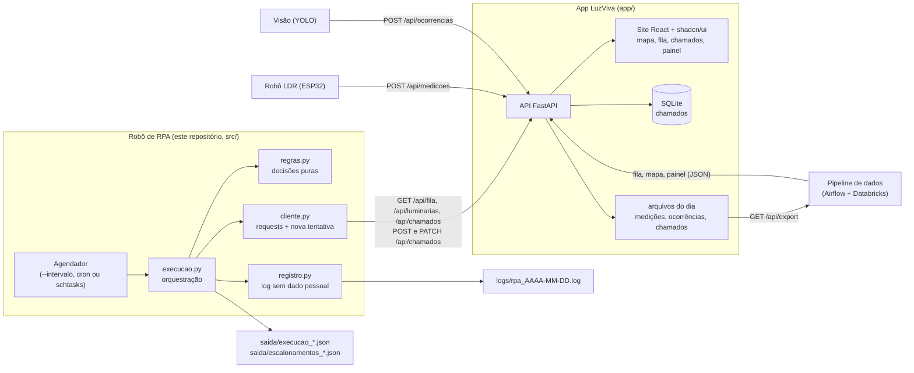

# LuzViva: robô de RPA que abre e acompanha chamados de iluminação pública

Projeto da Global Solution FIAP 2026.2 (CitizenTech), disciplina **Robotic Process Automation**
(professores Bruno Diniz e Cibele Ribeiro). Este repositório traz o robô de RPA e o MVP que ele
integra (site + API do LuzViva), prontos para rodar juntos com um comando.

<p align="center">
  <a href="video/luzviva-explica-ep01.mp4">
    
  </a><br>
  <a href="video/luzviva-explica-ep01.mp4">Vídeo explicativo (36 s)</a>
</p>

## Ficha Técnica

| Campo | Conteúdo |
|---|---|
| Nome do produto | LuzViva (provisório) |
| Cidadão e território | Quem circula à noite nas áreas-piloto Sé, Pinheiros e Campo Limpo, em São Paulo |
| Problema, em uma frase | A cidade só descobre que uma luminária apagou quando alguém reclama, e a rua fica escura e insegura até lá |
| Proposta de valor | Achar a falha antes da reclamação e dizer ao gestor o que consertar primeiro, com evidência de duas fontes |
| Arquitetura: componentes | Robô LDR, app com visão computacional, pipeline de dados, assistente de IA, robô de RPA e plataforma em nuvem |
| Fontes de dados | Cadastro ILUME (GeoSampa), SP156, Open-Meteo, medições do robô, ocorrências do app, chamados do RPA |
| Modelos de IA | YOLO11 para luminárias, LLM local com RAG e agente, classificador TinyML no ESP32 |
| URL do MVP e repositório | MVP: (preencher quando publicar) · Repositório: https://github.com/devCaiqueWS/RoboticProcessAutomation |
| Indicadores de impacto | % de falhas achadas antes de relato; tempo até o reparo; horas-luminária no escuro por noite |
| ODS | 11 (meta 11.7, espaços públicos seguros), 9 (infraestrutura funcionando), 10 (periferia espera mais pelo reparo?) |

## Integrantes

| Nome | RM |
|---|---|
| Caíque Walter Silva | RM550693 |
| Matheus José de Lima Costa | RM551157 |
| João Paulo Fonseca Zamperlini | RM99279 |
| Guilherme Monteiro Espim | RM99499 |
| Guilherme Nobre Bernardo | RM98604 |

## Sumário

1. [O problema e o objetivo](#o-problema-e-o-objetivo)
2. [O que o robô faz](#o-que-o-robô-faz)
3. [O site e a API (MVP)](#o-site-e-a-api-mvp)
4. [Arquitetura](#arquitetura)
5. [Tecnologias e por quê](#tecnologias-e-por-quê)
6. [Estrutura do repositório](#estrutura-do-repositório)
7. [Como rodar](#como-rodar)
8. [Testes](#testes)
9. [Logs, auditoria e evidências](#logs-auditoria-e-evidências)
10. [Exceções e recuperação](#exceções-e-recuperação)
11. [Segurança e LGPD](#segurança-e-lgpd)
12. [ROI](#roi)
13. [Vídeo](#vídeo)
14. [Publicação](#publicação)
15. [Documentação e links](#documentação-e-links)

## O problema e o objetivo

A Prefeitura de São Paulo publica o cadastro de 662.945 pontos de luz (GeoSampa/ILUME), mas nenhum
dado aberto diz quais estão apagados: a cidade só descobre quando alguém reclama. Mesmo depois do
relato, abrir um chamado por poste, cobrar o prazo da equipe e conferir o reparo é trabalho manual
e repetitivo.

**Objetivo da automação:** transformar a fila de manutenção priorizada do LuzViva em chamados
abertos, acompanhados e concluídos sem trabalho manual, de hora em hora.
**Benefício ao cidadão:** a rua escura entra na fila antes da reclamação, o poste mais urgente é
atendido primeiro e nenhum chamado fica esquecido depois do prazo.

## O que o robô faz

Hoje alguém olha a lista de luminárias com problema, abre um chamado por poste, cobra o prazo da
equipe e confere se o reparo foi feito. O robô faz esse trabalho a cada hora:

1. Lê a fila de manutenção priorizada (`GET /api/fila`) que o pipeline de dados publica pelo app.
2. **Repetição sobre a fila, com decisão por item:**
   - prioridade >= 30 e sem chamado aberto para a placa: abre chamado (`POST /api/chamados`) para a equipe da área;
   - prioridade < 30: "monitorar";
   - placa já com chamado (ou repetida na fila, ou 409 da API): "duplicado";
   - dado inconsistente (placa fora do padrão `IP` + 7 dígitos, prioridade fora de 0 a 100): "inválido".
3. **Repetição sobre os chamados abertos:**
   - aberto há 1 dia ou mais: passa para `em_atendimento`;
   - prazo vencido (5 dias se apagada, 10 se insuficiente): escala (log WARNING + arquivo de escalonamentos);
   - luminária medida `ok` depois da abertura: `concluido` (`PATCH /api/chamados/{id}`).
4. Grava o resumo da execução em log e JSON, com a duração (que mede o tempo do robô para o ROI).

| Regra | Valor |
|---|---|
| Corte para abrir chamado | prioridade >= 30 (0 a 100) |
| Prazo de reparo | 5 dias apagada, 10 dias insuficiente |
| Equipe por área | Sé: EQUIPE-CENTRO · Pinheiros: EQUIPE-OESTE · Campo Limpo: EQUIPE-SUL |
| Um chamado por placa | nunca abre dois chamados para a mesma placa enquanto houver um aberto |
| Destino | a API do próprio app LuzViva, **nunca** o SP156 real da Prefeitura |

O processo completo está desenhado em [BPMN 2.0](docs/processo.bpmn) (abre no bpmn.io e no Camunda
Modeler), em [Mermaid](docs/bpmn.md) e no [PDD](docs/PDD.md).

## O site e a API (MVP)

O app LuzViva é o centro do projeto: todos os componentes do grupo falam com ele por uma API REST,
e o site é onde o resultado do robô aparece para o gestor.

| Tela | O que faz |
|---|---|
| Mapa | Cada poste da área colorido pela situação (ok, insuficiente, apagada, sem medição), com a lista de falhas |
| Fila | Luminárias por prioridade, com a explicação de como cada prioridade foi calculada |
| Chamados | Os chamados que **o robô abriu**, com prazo, aviso de atraso e troca de status pelo gestor |
| Painel | Comparação das três áreas: % com falha, tempo até o reparo, chamados em aberto |
| Relatar | O cidadão fotografa o poste e informa a placa (foto gravada sem metadados) |
| Assistente | Perguntas sobre a fila, repassadas ao serviço de IA do grupo |

Detalhes do app, rotas e contratos: [app/README.md](app/README.md) e
[app/docs/especificacao_api.md](app/docs/especificacao_api.md).

## Arquitetura



| Módulo do robô | Responsabilidade |
|---|---|
| `src/luzviva_rpa/config.py` | Variáveis de ambiente e constantes das regras (corte 30, prazos 5/10 dias, equipes, timeout 20 s, 4 tentativas) |
| `src/luzviva_rpa/cliente.py` | Cliente HTTP com timeout, nova tentativa com espera exponencial (2, 4, 8 s) e erros claros |
| `src/luzviva_rpa/regras.py` | Funções puras: validar item, decidir abrir/monitorar/duplicado/inválido, decidir em_atendimento/escalar/concluir |
| `src/luzviva_rpa/execucao.py` | Uma execução: fase da fila, fase de acompanhamento, resumo e escalonamentos em JSON |
| `src/luzviva_rpa/registro.py` | Log em arquivo do dia e no terminal, horário de São Paulo, filtro que remove e-mail |
| `src/luzviva_rpa/__main__.py` | Linha de comando (`--simular`, `--intervalo`) |

## Tecnologias e por quê

| Tecnologia | Onde | Por quê |
|---|---|---|
| Python 3.11+ com `requests`, `logging` e `pathlib` | robô | O grupo inteiro (visão, IA, dados) usa Python; robô versionável, testável e sem licença paga |
| FastAPI + Pydantic + SQLite | API | Validação de entrada em todas as rotas, `/metrics` para o DevOps, persistência simples sem servidor de banco |
| React 19 + Vite + Tailwind + shadcn/ui + Leaflet | site | Interface acessível (axe-core sem violações), build estático servido pela própria API |
| Docker + Docker Compose | publicação | Sobe site, API e robô juntos, com a mesma configuração em qualquer máquina ou nuvem |
| pytest | testes | Os três cenários exigidos (sucesso, decisão, falha) e regras de borda rodam em segundos |

## Estrutura do repositório

```text
RoboticProcessAutomation/
├── README.md                 este arquivo
├── docker-compose.yml        site + API + robô rodando juntos
├── Dockerfile                imagem do robô
├── .env.example              variáveis (sem valores reais)
├── pyproject.toml            pacote do robô (src/)
├── requirements*.txt         dependências do robô
├── src/luzviva_rpa/          código do robô
├── tests/                    testes do robô e evidências (tests/evidencias/)
├── docs/                     BPMN, PDD, ROI, roteiros do vídeo e do PDF, guia de publicação
├── assets/                   resumos JSON de execuções reais (evidências)
├── logs/                     amostras de log sanitizadas
├── app/                      MVP: API FastAPI, site (frontend/ e static/), dados, testes
│   ├── Dockerfile            imagem do site + API
│   ├── app/                  código da API
│   ├── frontend/             código-fonte do site (React)
│   ├── static/               build do site servido pela API
│   ├── data/                 views do pipeline (fila, mapa, painel)
│   └── docs/                 especificação da API e contratos de dados
└── video/                    vídeo explicativo, roteiro, legendas e storyboard
```

## Como rodar

### Tudo junto com Docker (recomendado)

Requisito: Docker com Docker Compose.

```bash
cp .env.example .env          # opcional: defina LUZVIVA_API_TOKEN e LUZVIVA_RPA_INTERVALO
docker compose up --build
```

- Site e API: http://localhost:8000 (documentação interativa da API em http://localhost:8000/docs)
- O robô espera a API ficar saudável, roda uma vez na hora e depois a cada `LUZVIVA_RPA_INTERVALO`
  segundos (3600 por padrão; use 60 para demonstrar). Acompanhe com `docker compose logs -f rpa`.
- Os chamados abertos pelo robô aparecem na tela **Chamados** do site.

### Sem Docker (dois terminais)

Requisito: Python 3.11 ou mais novo (testado no 3.14; as imagens Docker usam o 3.13).

Terminal 1, site + API:

```bash
cd app
python -m venv .venv
source .venv/bin/activate        # Windows: .venv\Scripts\activate
pip install -r requirements.txt
uvicorn app.main:app --port 8000
```

Terminal 2, robô (na raiz do repositório):

```bash
python -m venv .venv
source .venv/bin/activate        # Windows: .venv\Scripts\activate
pip install -r requirements.txt
export LUZVIVA_API_URL=http://127.0.0.1:8000     # Windows: set LUZVIVA_API_URL=http://127.0.0.1:8000
python -m luzviva_rpa
```

| Comando do robô | O que faz |
|---|---|
| `python -m luzviva_rpa` | Uma execução completa (o modo usado pelo agendador) |
| `python -m luzviva_rpa --simular` | Decide e registra no log, mas não faz POST nem PATCH (ensaio seguro) |
| `python -m luzviva_rpa --intervalo` | Fica rodando, uma execução por hora |
| `python -m luzviva_rpa --intervalo 600` | Fica rodando, uma execução a cada 10 minutos |

Código de saída: `0` tudo certo; `1` falha em item ou erro de fase (API fora, fila inválida);
`2` configuração inválida.

| Variável | Quem usa | Default | Uso |
|---|---|---|---|
| `LUZVIVA_API_URL` | robô | (obrigatória) | URL base da API do app |
| `LUZVIVA_API_TOKEN` | robô e API | vazio | Header `X-API-Key` nas rotas de escrita; vazio = modo desenvolvimento |
| `LUZVIVA_RPA_INTERVALO` | compose | `3600` | Segundos entre execuções do robô |
| `LUZVIVA_RPA_DIR_LOGS` / `LUZVIVA_RPA_DIR_SAIDA` | robô | `logs` / `saida` | Pastas do log e dos JSON de resumo |
| `LUZVIVA_RPA_ESPERA_BASE` | robô | `2` | Primeira espera da nova tentativa (dobra a cada vez) |
| `IA_URL`, `VISAO_URL`, `LUZVIVA_CORS` | API | vazio | Serviços de IA e visão do grupo e CORS (veja `app/README.md`) |

Nenhuma URL, chave ou token fica no código: tudo vem do ambiente.

### Agendamento sem Docker

Windows (Agendador de Tarefas), com as variáveis definidas para o usuário (`setx LUZVIVA_API_URL ...`):

```bat
schtasks /Create /TN "LuzViva RPA" /SC HOURLY /MO 1 /ST 00:00 ^
  /TR "cmd /c cd /d C:\caminho\RoboticProcessAutomation && .venv\Scripts\python.exe -m luzviva_rpa"
```

Linux (cron, `crontab -e`):

```cron
0 * * * * cd /opt/RoboticProcessAutomation && LUZVIVA_API_URL=https://url-do-app .venv/bin/python -m luzviva_rpa >/dev/null 2>&1
```

### Sem o app no ar: API simulada

`tests/api_simulada.py` sobe, só com a biblioteca padrão, uma API com as mesmas rotas e regras e
dados simulados que exercitam todas as decisões do robô:

```bash
python tests/api_simulada.py --porta 8799 --token token-demo
# em outro terminal
LUZVIVA_API_URL=http://127.0.0.1:8799 LUZVIVA_API_TOKEN=token-demo python -m luzviva_rpa
```

## Testes

```bash
pip install -r requirements-dev.txt && pytest -q                      # robô: 68 testes
cd app && pip install -r requirements-dev.txt && pytest -q             # API: 55 testes
cd app/frontend && npm ci && npm run lint && npm run build             # site: lint, tipos e build
```

| Arquivo | Cobre |
|---|---|
| `tests/test_cenarios.py` | Os três cenários avaliados: **sucesso** (abre chamados), **decisão** (corte, duplicado, inválido, placa repetida) e **falha** (API fora, JSON inválido, fila sem lista, queda no meio da fila), acompanhamento e LGPD no log |
| `tests/test_regras.py` | Regras puras e limites (prioridade 29/30, 150, prazos 5/10 dias, conclusão) |
| `tests/test_cliente.py` | Timeout, 4 tentativas com espera 2/4/8 s, 409, 422, JSON inválido, header `X-API-Key` |
| `tests/test_integracao_api_simulada.py` | Ponta a ponta por HTTP; a segunda execução não duplica; token errado |
| `tests/test_cli.py` | Sem `LUZVIVA_API_URL` (código 2) e porta sem servidor (código 1, log de erro) |
| `app/tests/` | Rotas da API, chamados (transições, 409, token), fotos (EXIF, bomba de descompressão), assistente fora do ar, export |

Saída da última execução da suíte do robô: [tests/evidencias/pytest_saida.txt](tests/evidencias/pytest_saida.txt).

## Logs, auditoria e evidências

| Onde | O quê |
|---|---|
| `logs/rpa_AAAA-MM-DD.log` | Data/hora, item (placa), decisão, sucesso, falha e erro de cada execução; resumo no fim |
| `saida/execucao_AAAAMMDD_HHMMSS.json` | `inicio`, `fim`, `duracao_s` e contagens (`lidos`, `abertos`, `monitorar`, `duplicados`, `invalidos`, `em_atendimento`, `escalados`, `concluidos`, `falhas`) |
| `saida/escalonamentos_AAAA-MM-DD.json` | Chamados com prazo vencido: `id_chamado`, `placa`, `area`, `dias_em_aberto`, `prazo_dias` |
| [`logs/exemplo_execucao_sucesso.log`](logs/exemplo_execucao_sucesso.log) | Duas execuções reais: a segunda não abre nada (idempotência) |
| [`logs/exemplo_falha_api.log`](logs/exemplo_falha_api.log) | API desligada: 4 tentativas por fase, erro registrado e resumo gravado |
| [`assets/`](assets/) | Resumos e escalonamentos dessas execuções |

**Integração com o MVP comprovada:** contra a API real do app, a primeira execução leu 134 itens
da fila e abriu 88 chamados em 4,4 s; a segunda abriu zero (111 duplicados). Os chamados aparecem
na tela Chamados do site e voltam ao pipeline de dados no arquivo do dia `chamados_rpa`.

## Exceções e recuperação

| Exceção | O que o robô faz |
|---|---|
| API fora do ar ou lenta | Nova tentativa com espera de 2, 4 e 8 s; depois registra o erro e segue para a próxima fase |
| API cai no meio da fila | Após 3 falhas seguidas para a fase e deixa o resto para a próxima hora (não gasta 1,5 min por item) |
| Fila vazia, JSON inválido ou sem lista de dados | Registra e pula a fase da fila; a fase de acompanhamento roda mesmo assim |
| Placa repetida na fila ou com chamado aberto | Conta como duplicado; a API também recusa com 409 |
| Prioridade fora de 0 a 100 ou placa fora do padrão | Conta como inválido e segue para o próximo item |
| Falha em um item | Conta a falha e continua a repetição: um item ruim não para a execução |

## Segurança e LGPD

- O robô só registra placa da luminária, id do chamado, prioridade, status e contagens; um filtro
  remove qualquer e-mail que chegue ao log. Nenhum nome, e-mail ou telefone de cidadão sai do app.
- Rotas de escrita de máquina (medições, ocorrências da visão, chamados) exigem `X-API-Key` quando `LUZVIVA_API_TOKEN` está definido (comparação
  em tempo constante). O export das ocorrências (que tem localização de cidadão) também.
- Fotos de cidadãos são regravadas sem EXIF/GPS, com limite de tamanho e de resolução.
- Containers rodam com usuário sem privilégio; segredos só por variável de ambiente; `.env` fora do Git.
- As amostras de dados deste repositório são simuladas pelo pipeline do grupo; o campo `cidadao`
  (nomes e telefones fictícios) foi removido da cópia pública.

## ROI

Modelo da planilha de ROI da aula, com o tempo do robô medido no log e as premissas do processo
manual marcadas como estimativas ([docs/roi.md](docs/roi.md), [planilha](docs/roi.csv)):

| Indicador | Valor |
|---|---|
| Economia de horas por mês | 144,8 h |
| Economia líquida por mês | R$ 6.147,50 |
| Payback | 1,5 mês |
| ROI anual | 720% |
| FTEs recuperados | 0,85 |

## Vídeo

- [`video/luzviva-explica-ep01.mp4`](video/luzviva-explica-ep01.mp4): vídeo explicativo de 36 s
  com o mascote do LuzViva (vertical 1080 × 1920), mostrando o site e o robô com telas reais.
  Roteiro, legendas e storyboard em [`video/`](video/).
- Vídeo da disciplina de RPA (até 3 min, YouTube não listado): (preencher). Roteiro em
  [docs/roteiro_video.md](docs/roteiro_video.md).

## Publicação

Passo a passo para colocar site, API e robô no ar juntos (VM com Docker, Render ou Azure) em
[docs/publicacao.md](docs/publicacao.md).

## Documentação e links

| Documento | Conteúdo |
|---|---|
| [docs/PDD.md](docs/PDD.md) | Process Design Document: AS-IS, TO-BE, entradas, etapas, decisões, exceções, saídas |
| [docs/processo.bpmn](docs/processo.bpmn) / [docs/bpmn.md](docs/bpmn.md) | Fluxo BPMN 2.0 e a mesma versão em Mermaid |
| [docs/roi.md](docs/roi.md) | Cálculo do ROI |
| [docs/relatorio_pdf_roteiro.md](docs/relatorio_pdf_roteiro.md) | Roteiro do PDF na ordem pedida |
| [docs/publicacao.md](docs/publicacao.md) | Como publicar site + robô |
| [app/docs/especificacao_api.md](app/docs/especificacao_api.md) | Rotas, regras e contratos da API |

- Repositório de dados do grupo: https://github.com/GN0Ber/gs-citizentech-dados
- MVP publicado: (preencher)
