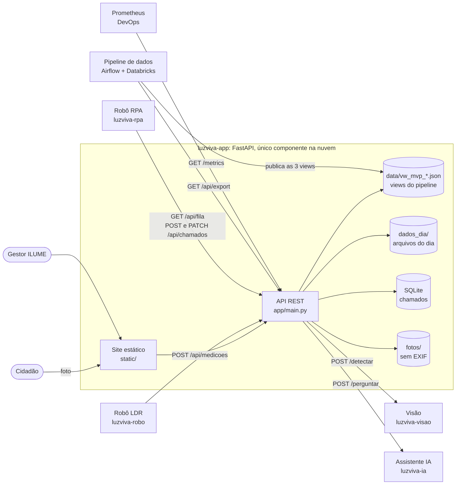

# Ficha Técnica: LuzViva (app, site + API)

> Parte do repositório [RoboticProcessAutomation](../README.md): o robô de RPA fica na raiz e
> este app é o MVP que ele integra. Para subir os dois juntos: `docker compose up --build` na raiz.

| Campo | Conteúdo |
|---|---|
| Nome do produto | LuzViva (provisório) |
| Cidadão e território | Quem circula à noite nas áreas-piloto Sé, Pinheiros e Campo Limpo, em São Paulo |
| Problema, em uma frase | A cidade só descobre que uma luminária apagou quando alguém reclama, e a rua fica escura e insegura até lá |
| Proposta de valor | Achar a falha antes da reclamação e dizer ao gestor o que consertar primeiro, com evidência de duas fontes |
| Arquitetura: componentes | Robô LDR, app com visão computacional, pipeline de dados, assistente de IA, robô de RPA e plataforma em nuvem |
| Fontes de dados | Cadastro ILUME (GeoSampa), SP156, Open-Meteo, medições do robô, ocorrências do app, chamados do RPA |
| Modelos de IA | YOLO11 para luminárias, LLM local com RAG e agente, classificador TinyML no ESP32 |
| URL do MVP e repositório | (preencher quando subir) |
| Indicadores de impacto | % de falhas achadas antes de relato; tempo até o reparo; horas-luminária no escuro por noite |
| ODS | 11 (meta 11.7, espaços públicos seguros), 9 (infraestrutura funcionando), 10 (periferia espera mais pelo reparo?) |

## Equipe

| Pessoa | RM | Matéria(s) |
|---|---|---|
| Caíque Walter Silva | RM550693 | RPA + front-end/API do app (MVP) |
| Matheus José de Lima Costa | RM551157 | Secure DevOps & Cloud |
| João Paulo Fonseca Zamperlini | RM99279 | Applied Computer Vision + Generative AI |
| Guilherme Monteiro Espim | RM99499 | Maker Lab + BI & Startup (pitch) |
| Guilherme Nobre Bernardo | RM98604 | Big Data |

Endereço da API: (preencher quando o Matheus publicar)

## O que é este app

O LuzViva acha a luminária apagada antes de o cidadão reclamar e diz ao gestor o que consertar
primeiro. Este repositório é o centro do sistema: uma API FastAPI que todos os componentes usam e
o site (mapa, fila, painel, foto do cidadão e assistente) servido pela mesma aplicação.

- O robô (ESP32 + LDR) manda medições de luz para `POST /api/medicoes`.
- O site manda a foto do cidadão para `POST /api/fotos`; a API tira o EXIF, chama a visão
  computacional e grava a ocorrência. A visão em lote usa `POST /api/ocorrencias`.
- O pipeline de dados baixa os arquivos do dia em `GET /api/export/...` e devolve três views
  (mapa, fila e painel), que a API publica em `GET /api/luminarias`, `/api/fila` e `/api/painel`.
- O robô de RPA lê a fila e abre e acompanha chamados em `/api/chamados`.
- O assistente de IA responde perguntas sobre a fila por `POST /api/assistente`.

## Arquitetura



Módulos:

| Arquivo | O que faz |
|---|---|
| `app/main.py` | rotas, autenticação por token, CORS, métricas e montagem do site |
| `app/modelos.py` | modelos Pydantic dos contratos (validação de toda entrada) |
| `app/armazenamento.py` | arquivos do dia com escrita atômica sob trava |
| `app/chamados.py` | chamados em SQLite, regras de transição e espelho no arquivo do dia |
| `app/config.py` | configuração lida das variáveis de ambiente |
| `scripts/gerar_views_simuladas.py` | gera as três views a partir de `amostras/` enquanto o pipeline real não publica |

A decisão de usar arquivos do dia + SQLite está em
[docs/adr/001-fastapi-arquivos-diarios-sqlite.md](docs/adr/001-fastapi-arquivos-diarios-sqlite.md).

## Como rodar localmente

Requer Python 3.12 ou mais novo (testado com 3.14).

```bash
python -m venv .venv
# Windows (Git Bash): source .venv/Scripts/activate   |   PowerShell: .venv\Scripts\Activate.ps1
# Linux/macOS: source .venv/bin/activate
pip install -r requirements-dev.txt        # só para rodar: requirements.txt
python scripts/gerar_views_simuladas.py    # (re)gera data/vw_mvp_*.json a partir de amostras/
uvicorn app.main:app --reload              # http://127.0.0.1:8000  (docs da API em /docs)
pytest -q
```

Para usar um arquivo de configuração: `cp .env.example .env`, ajuste e rode
`uvicorn app.main:app --reload --env-file .env`.

O código do site fica em `frontend/` (React + shadcn/ui); `static/` é gerado por `npm run build` dentro de
`frontend/` e não deve ser editado à mão (veja `frontend/README.md`).

## Variáveis de ambiente

| Variável | Para que serve | Padrão |
|---|---|---|
| `LUZVIVA_DATA` | pasta das views do pipeline (somente leitura) | `data` |
| `LUZVIVA_DIA` | pasta dos arquivos do dia | `dados_dia` |
| `LUZVIVA_DB` | arquivo SQLite dos chamados | `dados_dia/luzviva.db` |
| `LUZVIVA_FOTOS` | pasta das fotos já sem EXIF | `fotos` |
| `LUZVIVA_API_TOKEN` | se definido, exige `X-API-Key` em `POST /api/medicoes`, `POST /api/chamados`, `PATCH /api/chamados/*` e `GET /api/export/*` (o pipeline envia o header) | vazio (aberto, com aviso no log) |
| `LUZVIVA_CORS` | origens permitidas, separadas por vírgula | vazio (nenhuma) |
| `IA_URL` | serviço do assistente (`POST {IA_URL}/perguntar`) | vazio (assistente indisponível) |
| `VISAO_URL` | serviço de visão (`POST {VISAO_URL}/detectar`) | vazio (foto sem visão) |

Nenhuma chave ou URL fica no código. `.env` está no `.gitignore`; use `.env.example` como modelo.

## Rotas

Comportamento completo (códigos de erro, transições, persistência) na
[especificação da API](docs/especificacao_api.md), que é a fonte da verdade. Os formatos JSON
estão no [contrato de dados](docs/contrato_mvp_dados.md).

| Rota | Quem chama | O que faz |
|---|---|---|
| `GET /health` | DevOps | saúde e quais views existem |
| `GET /metrics` | DevOps | métricas Prometheus |
| `GET /api/luminarias?subprefeitura=&situacao=&placa=` | site, assistente | mapa (503 se a view não existe) |
| `GET /api/fila?subprefeitura=` | RPA, site, assistente | fila por prioridade, com o chamado atual do banco |
| `GET /api/painel` | site, pitch | números por subprefeitura |
| `POST /api/medicoes` | robô | grava a medição no arquivo do dia (201; 200 se repetida) |
| `POST /api/ocorrencias` | visão em lote | grava a ocorrência (descarta `cidadao`) |
| `POST /api/fotos` | site | foto do cidadão: tira EXIF, chama a visão, grava a ocorrência |
| `GET /api/chamados?status=&placa=&area_piloto=` | RPA, site | lista chamados |
| `GET /api/chamados/{id_chamado}` | RPA, site | um chamado |
| `POST /api/chamados` | RPA | abre chamado (409 se a placa já tem um aberto) |
| `PATCH /api/chamados/{id_chamado}` | RPA, site | muda `status`, `equipe`, `concluido_em` |
| `POST /api/assistente` | site | repassa a pergunta ao serviço de IA |
| `GET /api/export/{fonte}?data=AAAA-MM-DD` | pipeline | arquivo do dia de `medicoes_robo`, `ocorrencias_app` ou `chamados_rpa` |

Detalhes que a especificação deixou em aberto e foram fechados aqui:

- 409 de `POST /api/chamados`: `{"detail": {"erro": "...", "id_chamado": "CH-..."}}`, com o id do
  chamado que já existe.
- `POST /api/fotos`: `lat`, `lon` e `area_piloto` são obrigatórios na prática (o contrato 2 exige);
  `categoria` também, a menos que a visão responda uma. Sem eles a resposta é 422 e nada é gravado.
- `POST /api/medicoes` aceita `lat`/`lon` nulos (robô sem fix de GPS); o pipeline decide se descarta.
- Categorias aceitas: `luminaria_apagada`, `luminaria_acesa`, `luminaria_acesa_de_dia`,
  `luminaria_piscando`, `poste_danificado`, `fiacao_exposta` (união da lista do contrato de dados
  com a da skill do projeto).
- `PATCH` com campo fora de `status`, `equipe` e `concluido_em` dá 422.

## Privacidade e LGPD

- Foto do cidadão é dado pessoal (rosto, placa de carro, local). A API reencoda toda foto com
  Pillow antes de guardar ou mandar para a visão: isso remove EXIF, inclusive as coordenadas GPS e
  o modelo do celular. A foto é salva com um `foto_id` aleatório (`secrets.token_hex(8)`), sem
  nome de arquivo original.
- A visão recebe só a imagem limpa, sem os campos do formulário.
- `cidadao` (nome, e-mail, telefone) é descartado na entrada de `POST /api/ocorrencias` e nunca
  chega ao arquivo do dia, aos logs ou a rota pública.
- Logs registram só o tipo de falha dos serviços externos, nunca o conteúdo enviado.
- Fotos e arquivos do dia ficam fora do Git (`.gitignore`).

## O que é simulado e por quê

Os três JSON em `data/` não vêm do pipeline real: são gerados por
`scripts/gerar_views_simuladas.py` a partir das amostras do repositório de dados (`amostras/`), que
misturam o cadastro real da ILUME com medições, ocorrências e chamados simulados. Isso deixa o app,
o RPA e o assistente trabalharem antes de o pipeline publicar as views reais, no mesmo formato.
Quando o pipeline publicar, basta substituir os arquivos em `LUZVIVA_DATA`. Como e por que cada
parte foi simulada: [docs/dados_simulados.md](docs/dados_simulados.md).

## Infraestrutura

Neste repositório o app roda junto com o robô de RPA pelo `docker-compose.yml` da raiz (imagem em
`app/Dockerfile`, usuário sem privilégio, estado em volume). Guia em
[../docs/publicacao.md](../docs/publicacao.md). A infraestrutura de nuvem da disciplina de DevOps
(Terraform, pipeline de segurança e monitoramento) é a entrega do Matheus. Sem Docker, o app só
precisa de `pip install -r requirements.txt`, `uvicorn app.main:app --host 0.0.0.0 --port 8000`,
as variáveis acima e pastas persistentes para `dados_dia/` e `fotos/`.
