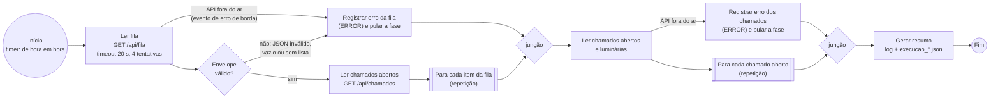
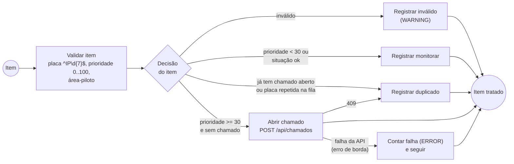
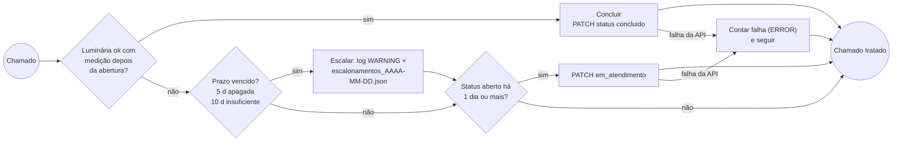

# Fluxo do robô (BPMN)

O modelo oficial está em [`processo.bpmn`](processo.bpmn) (BPMN 2.0 com coordenadas de diagrama):
abra em https://demo.bpmn.io (File > Open) ou no Camunda Modeler. Abaixo, o mesmo fluxo em Mermaid
para leitura rápida no GitHub.

## Processo principal

## Subprocesso: cada item da fila (multi-instância sequencial)

## Subprocesso: cada chamado aberto ou em atendimento (multi-instância sequencial)

## Como ler o modelo

| Elemento BPMN | Onde aparece | Significado no robô |
|---|---|---|
| Evento de início de timer (`R/PT1H`) | Início | Agendador do sistema operacional chama `python -m luzviva_rpa` de hora em hora |
| Tarefa de serviço | Ler fila, ler chamados, abrir, PATCH | Chamada HTTP à API do app (`cliente.py`) |
| Evento de erro de borda | Ler fila, ler chamados/luminárias, abrir, PATCH | `ApiIndisponivel` depois de 4 tentativas com espera 2, 4, 8 s, ou erro HTTP |
| Gateway exclusivo | Envelope válido?, Decisão do item, Conclui?, Prazo?, 1 dia? | Funções puras de `regras.py` |
| Subprocesso multi-instância sequencial (marcador de três barras) | Para cada item / para cada chamado | Laços `for` de `execucao.py` sobre as coleções |
| Gateways sem nome | Junções | Os caminhos se reencontram; uma fase que falha não impede a seguinte |

Decisões de desenho:

- A fase de acompanhamento roda mesmo quando a fila falhou: um problema na view da fila não deve
  impedir que chamados antigos sejam concluídos ou escalados.
- Escalonamento é verificado antes do PATCH de `em_atendimento` e não depende dele: se o PATCH falhar,
  o alerta de prazo vencido sai mesmo assim.
- Uma falha num item (POST ou PATCH) conta como `falhas` e o laço segue para o próximo item.
